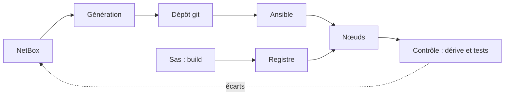

# Architecture de référence

Cible de la plateforme et modèle type de déploiement. Toute nouvelle brique s'y conforme ; tout écart est inscrit
au §7. État de départ : commit `e96e20f`. Les adresses et le détail des nœuds restent dans NetBox.

## 1. Principes

| # | Principe |
|---|---|
| P1 | Une seule source de vérité pour l'infrastructure : NetBox |
| P2 | Tout ce qui est déployé est généré ou versionné, jamais édité sur un nœud |
| P3 | Une brique = un conteneur ou une pile Compose, une image versionnée, remplaçable |
| P4 | Les données métier circulent par l'UNS (cible) ; les fichiers métier par le service de fichiers |
| P5 | Les flux sont déclarés avant d'être ouverts |
| P6 | Le procédé ne dépend ni d'internet, ni de la chaîne de déploiement, ni des niveaux supérieurs |
| P7 | Standards ouverts et composants open source |
| P8 | Sécurité reportée à la GIA : les emplacements sont prévus, les écarts sont écrits |
| P9 | Sobriété : un composant n'est ajouté que pour un besoin identifié |

Schéma : `archi_plateforme.drawio` (mode opératoire, lot S).

## 2. Vue fonctionnelle (repère : ISA-95 / IEC 62264)

| Niveau | Rôle | Existant | Cible |
|---|---|---|---|
| 0 | Procédé physique | `sim-rincage` (simulé) | Un second procédé |
| 1 | Mesure et action | Entrées et sorties Modbus du simulateur | |
| 2 | Contrôle et supervision | `api-rincage`, `scada` | HA de la conduite (pi52) |
| 3 | Opérations de production | Aucun | Broker UNS, historien, tableaux de bord |
| 4 | Gestion d'entreprise | Aucun | Hors périmètre actuel |
| Transverse | Socle | NetBox, `ha-cluster`, FTP et rsync | Registre, dépôt, Ansible, CI, temps, DNS, supervision, GIA |

L'UNS est un point d'échange transverse entre niveaux. Il ne remplace pas les échanges de contrôle (Modbus, OPC-UA
vers le SCADA).

## 3. Zones et conduits (repère : IEC 62443)

La segmentation s'inspire de la norme. Aucune analyse de risque ni niveau de sécurité cible (SL-T) n'est établi :
ne pas la présenter comme conforme.

| Zone | Réseau | Contenu |
|---|---|---|
| Terrain | VLAN20 | Simulateur, interface terrain de l'automate |
| Contrôle et supervision | VLAN30 | OPC-UA de l'automate, SCADA |
| Administration et socle | VLAN10 | Nœuds, HA, déploiement |
| Opérations (niveau 3) | VLAN40, **envisagé** (§6) | Broker, historien, tableaux de bord |
| Externe / sas | Réseau de la box | Poste d'administration |

| Conduit autorisé en cible | Protocole | État |
|---|---|---|
| Automate → simulateur | Modbus TCP 502 | En place |
| SCADA → automate | OPC-UA 4840 | En place |
| Passerelle UNS → automate (lecture) | OPC-UA 4840 | À créer |
| Passerelle et consommateurs → broker | MQTT 1883 | À créer |
| Nœuds → registre | HTTP 5000 | À créer |
| pi51 → nœuds (déploiement) | SSH 22 | À créer |
| Sas → NetBox, registre, dépôt, IHM | HTTP, SSH | Partiel |

## 4. Plans et chaîne de déploiement

Trois plans indépendants : **procédé** (Modbus, OPC-UA, HA), **données** (UNS, fichiers métier), **gestion**
(NetBox, git, registre, Ansible). L'arrêt du plan de gestion n'arrête pas le procédé.



## 5. Modèle type de déploiement

### 5.1 Classes

| Classe | Usage | Déploiement | Exigences propres | Exemples |
|---|---|---|---|---|
| **A. Simple** | Sans état à conserver | `pull`, `up -d` | Sonde de santé | Passerelle UNS |
| **B. Persistant** | Avec données | Sauvegarde, `pull`, `up -d` | Volume déclaré, sauvegarde et restauration testées, amorçage sans écrasement | Registre, SCADA, broker, historien |
| **C. Haute disponibilité** | Actif et passif | Passif d'abord, bascule, ancien maître | `restart: "no"`, `create` seulement, une seule instance active, bascule testée | Automate, simulateur |

L'agent `ha-cluster` suit la procédure HA du mode opératoire mais tourne sur les deux nœuds (`up -d`).

### 5.2 Fiche de brique

Section « Fiche de brique » du `README.md` de chaque brique. Les valeurs déjà dans NetBox y sont référencées, pas
recopiées.

```markdown
## Fiche de brique
- Rôle :
- Niveau ISA-95 / zone :
- Classe de déploiement : A | B | C
- Service NetBox / cluster :
- Image et origine (construite | tierce), licence :
- Flux entrants et sortants : (déclarés dans NetBox)
- Données produites et consommées : (topics, fichiers)
- Données persistantes, sauvegarde, restauration :
- Dépendances, et comportement si elles manquent :
- Santé : comment la vérifier
- Test avant publication / contrôle après déploiement :
- Retour arrière :
- Écarts à l'architecture de référence :
```

### 5.3 Cycle de vie

| Étape | Action | Preuve |
|---|---|---|
| 1. Déclarer | Fiche, migration NetBox (service, flux) | `synchro.py` sans erreur |
| 2. Construire | Version figée, `linux/arm64` | Tests verts |
| 3. Publier | Registre local, version jamais réécrite | Image présente |
| 4. Déployer | Ansible selon la classe | Exécution sans échec |
| 5. Contrôler | Non-régression (modop, §4), test fonctionnel | Résultats avant et après |
| 6. Tracer | Journal, README, commit | `git status` propre |

Une brique est **terminée** quand les six preuves existent et que son retour arrière a été essayé.

## 6. Décisions

| # | Décision | Statut | Raison |
|---|---|---|---|
| D1 | NetBox source de vérité | Appliquée | Un seul modèle, déploiements générés |
| D2 | Docker Compose, agent HA keepalived | Appliquée | Macvlan à IP fixes, Pi 3B ; pas d'orchestrateur lourd |
| D3 | Registre local sur pi51 | Retenue | Autonomie, versions |
| D4 | Ansible sur pi51, à la demande | Retenue | Sans agent, rejouable |
| D5 | Build sur le sas dans un premier temps | Retenue | Dépendances de build hors plateforme |
| D6 | UNS MQTT, nommage inspiré d'ISA-95 | Retenue | Découplage producteurs et consommateurs |
| D7 | Zone Opérations dédiée (VLAN40) plutôt que le VLAN30 | **Envisagée, différée** | Sépare niveau 3 et contrôle ; à décider avant l'UNS (sinon broker en VLAN30) |
| D8 | Hébergement de NetBox et de la forge | À décider | Serveur dédié ou pi51 selon la RAM |

## 7. Écarts connus

| # | Écart | Traitement |
|---|---|---|
| E1 | VLAN20 ↔ VLAN30 et VLAN20/30 → VLAN10 ouverts en totalité | Audit de sécurité |
| E2 | Le SCADA interroge directement le simulateur (audit P6) | Conservé à la demande |
| E3 | pi51 cumule socle et conduite, présent sur trois VLAN | pi52 ou serveur dédié |
| E4 | Réplication à travers les zones (audit D4) ; fichiers répliqués non consommés (D1) | Revoir le service de fichiers |
| E5 | NetBox sur le sas | Mode opératoire, lot E |
| E6 | Accès large du sas vers la plateforme | Avec la GIA |
| E7 | Ni authentification, ni chiffrement, registre en HTTP | Avec la GIA |
| E8 | Bascule à froid (audit H4), nœud d'infrastructure unique | À traiter selon les besoins |
| E9 | Dépendances à internet | Registre du mode opératoire, §2 |
| E10 | Images de la plateforme en `:latest` (`api-rincage-image`, `simu-rincage-image`, `agent-ha`, `agent-sync`, `serveur-ftp`) ; seul `scada-fuxa:1.3.3` est versionné ; images de base non figées : `alpine:latest` (serveur FTP, agent de synchro), `python:3.11-slim` (automate, simulateur), `frangoteam/fuxa:latest` (`scada-dev`) | Mode opératoire, lot B |
| E11 | Le dépôt FTP du VLAN20 (`~/donnees/vlan20/donnees` sur pi51, répliqué sur pi31 et pi32) contient encore d'anciens artefacts de déploiement (`.tar`, compose, `config_cluster.json`) | Nettoyage avec accord (suppression) |
| E12 | L'interface `iaac/` charge `vis-network` sans version (`unpkg.com/vis-network/...`) | À figer |
